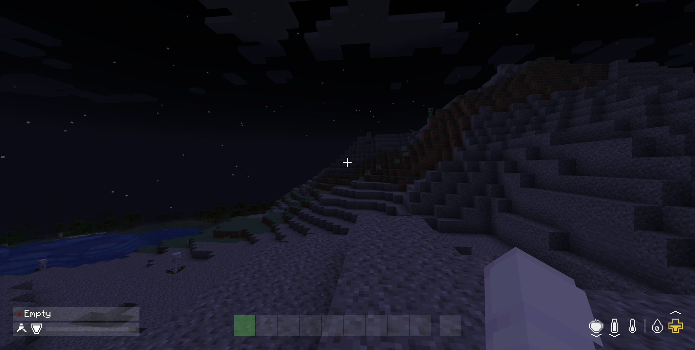
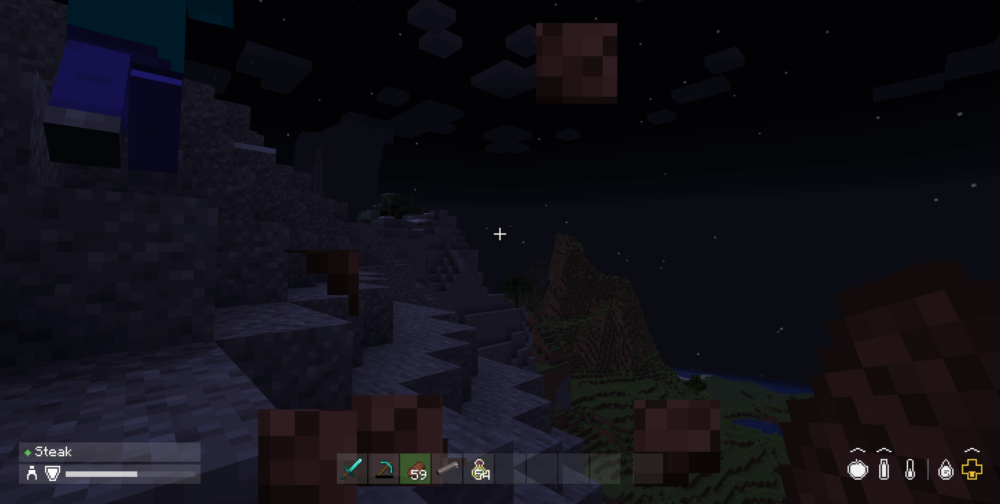
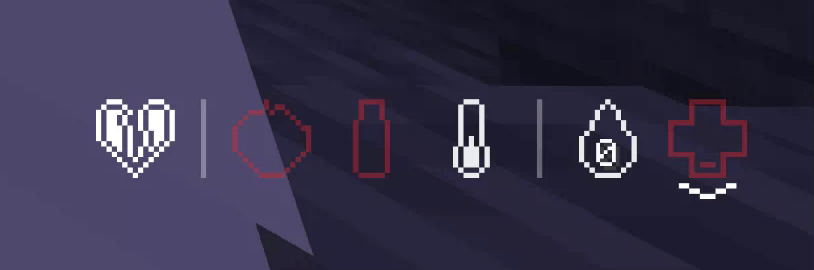
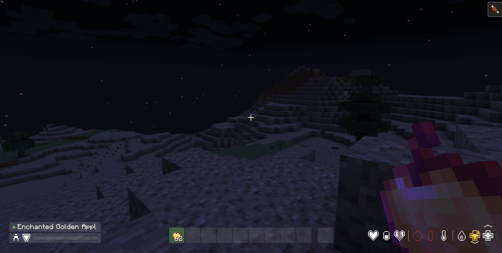
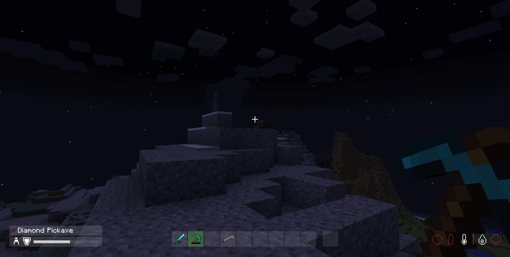

# DayZ Hotbar

[English](README.md) · [中文](README.zh.md) · **Français** · [日本語](README.ja.md) · [한국어](README.ko.md)

[](https://modrinth.com/mod/dayz-hotbar)
[](https://www.curseforge.com/minecraft/mc-mods/dayz-hotbar)
[](https://modrinth.com/mod/dayz-hotbar/versions)
[](https://modrinth.com/mod/dayz-hotbar)
[](https://www.curseforge.com/minecraft/mc-mods/dayz-hotbar)
[](LICENSE)
[](https://github.com/aacanadaa/DayZ-Hotbar/issues)
[](https://ko-fi.com/suoim)

Remplace le HUD de Minecraft par une barre d'accès rapide, un panneau joueur et une ligne de statuts façon DayZ, assortis à [DayZ Inventory](https://github.com/aacanadaa/DayZ-Inventory).

Mod purement client. Aucune API requise sur Fabric, Forge ou NeoForge.




---

## Versions supportées

| Minecraft | Fabric | Forge | NeoForge | Java |
| :--- | :---: | :---: | :---: | :---: |
| **1.20.1 – 1.20.4** | ✅ | — | — | 17 |
| **1.20.5** | ✅ | — | — | 21 |
| **1.20.6 – 1.21.1** | ✅ | ✅ | ✅ | 21 |
| **1.21.2** | ✅ | — | ✅ | 21 |
| **1.21.3 – 1.21.5** | ✅ | ✅ | ✅ | 21 |
| **1.21.6 – 1.21.7** | ✅ | — | ✅ | 21 |
| **1.21.8 – 1.21.11** | ✅ | ✅ | ✅ | 21 |
| **26.1 – 26.3** | ✅ | — | ✅ | 25 |

Prenez le fichier correspondant à votre version de Minecraft et à votre chargeur de mods (par exemple `dayz-hotbar-fabric-1.21.1-2.0.0+mc1.21.1.jar`).

---

## Fonctionnalités

### Barre d'accès rapide et barre de saut
- 9 emplacements + main secondaire sur une rangée translucide.
- Case vide discrète, case occupée plus claire, transition jaune vers vert lors du changement d'objet, rouge si l'objet est en recharge.
- À cheval (ou autre monture sauteuse), une fine barre de saut apparaît au-dessus de la barre sans la chevaucher.



### Statuts
- En bas à droite, icônes pixel-art sans texture (aucun conflit avec les packs de ressources) :
  - **Effets :** Cœur (positif), gélule (régénération), cœur brisé (négatif), avec fondu à la fin de l'effet.
  - **Survie :** Faim (avec saturation), soif, température, air (sous l'eau uniquement).
  - **Vie & XP :** Goutte d'XP avec niveau, croix d'absorption avec `+`, vie (ou vie de la monture).
- **Tough As Nails & Legendary Survival Overhaul :** Lit automatiquement la soif et la température corporelle lorsqu'un des deux mods est installé (couleurs froid/chaud et clignotement aux extrêmes). Sans eux, l'eau suit la faim et la température reste neutre.
- **Seuils et chevrons :** La vie, la faim, l'eau et l'air passent au jaune, au rouge puis clignotent. Les chevrons au-dessus ou en dessous indiquent une hausse ou une baisse (1 chevron pour une dérive normale, 2 pour un changement rapide).




### Panneau joueur
- En bas à gauche : nom et point d'état DayZ de l'objet tenu (neuf, usé, endommagé, très endommagé, détruit), posture (marche, sprint, accroupi) et barre d'armure.
- Se place automatiquement au-dessus de la barre sur les fenêtres étroites ou en **taille d'interface 4** pour éviter tout chevauchement.



---

## Configuration

`config/dayz_hotbar.properties` est créé au premier lancement :

| Option | Défaut | Description |
| :--- | :--- | :--- |
| `enableHotbar` | `true` | Remplacer la barre d'accès rapide vanilla |
| `enablePlayerPanel` | `true` | Afficher le panneau objet/armure en bas à gauche |
| `enableStatusRow` | `true` | Afficher les icônes de statut en bas à droite |
| `showJumpBar` | `true` | Afficher la barre de saut au-dessus de la barre |
| `showEffects` | `true` | Afficher les icônes d'effets de potion |
| `showHealth` | `true` | Afficher la vie |
| `showFood` | `true` | Afficher la faim |
| `showWater` | `true` | Afficher la soif |
| `showTemperature` | `true` | Afficher la température |
| `showAir` | `true` | Afficher l'air sous l'eau |
| `showAbsorption` | `true` | Afficher l'absorption |
| `showXp` | `true` | Afficher l'XP |
| `toughAsNailsIntegration` | `true` | Lire soif et température depuis Tough As Nails |
| `legendarySurvivalIntegration` | `true` | Lire soif et température depuis Legendary Survival Overhaul |

---

## Notes
- Les règles d'affichage vanilla restent actives (F1, mode spectateur, menus ouverts).
- L'indicateur d'attaque de la barre disparaît avec elle ; passez **Options graphiques → Indicateur d'attaque** sur *Viseur* pour le conserver.

---

## Compiler depuis les sources

Utilise [Stonecutter](https://stonecutter.kikugie.dev/) avec **JDK 25** pour Gradle :

```bash
./gradlew chiseledBuild          # Compiler les 50 jars
./gradlew :fabric:1.21.1:build   # Compiler une cible
./gradlew matrix                 # Lister les nœuds
```
