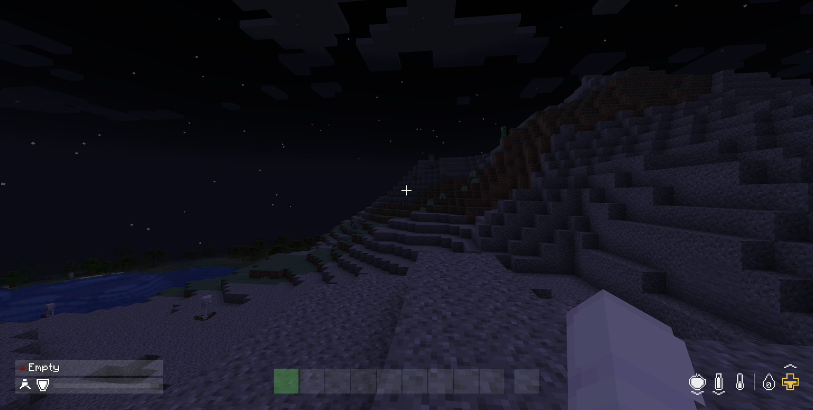
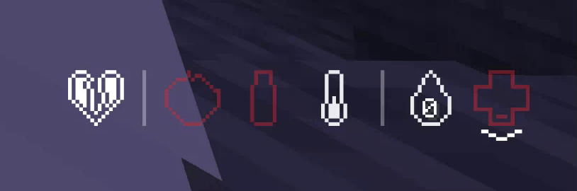

# DayZ Hotbar

[English](README.md) · [中文](README.zh.md) · [Français](README.fr.md) · **日本語** · [한국어](README.ko.md)

[](https://modrinth.com/mod/dayz-hotbar)
[](https://www.curseforge.com/minecraft/mc-mods/dayz-hotbar)
[](https://modrinth.com/mod/dayz-hotbar/versions)
[](https://modrinth.com/mod/dayz-hotbar)
[](https://www.curseforge.com/minecraft/mc-mods/dayz-hotbar)
[](LICENSE)
[](https://github.com/aacanadaa/DayZ-Hotbar/issues)
[](https://ko-fi.com/suoim)

Minecraft の HUD を [DayZ Inventory](https://github.com/aacanadaa/DayZ-Inventory) に合わせた DayZ 風のホットバー、プレイヤーパネル、ステータス表示に置き換えます。

クライアント専用 Mod です。Fabric / Forge / NeoForge のいずれでも前提 API Mod は不要です。




---

## 対応バージョン

| Minecraft | Fabric | Forge | NeoForge | Java |
| :--- | :---: | :---: | :---: | :---: |
| **1.20.1 – 1.20.4** | ✅ | — | — | 17 |
| **1.20.5** | ✅ | — | — | 21 |
| **1.20.6 – 1.21.1** | ✅ | ✅ | ✅ | 21 |
| **1.21.2** | ✅ | — | ✅ | 21 |
| **1.21.3 – 1.21.5** | ✅ | ✅ | ✅ | 21 |
| **1.21.6 – 1.21.7** | ✅ | — | ✅ | 21 |
| **1.21.8 – 1.21.11** | ✅ | ✅ | ✅ | 21 |
| **26.1 – 26.3** | ✅ | — | ✅ | 25 |

お使いの Minecraft バージョンとローダーの両方に一致する jar を選んでください（例：`dayz-hotbar-fabric-1.21.1-2.0.0+mc1.21.1.jar`）。

---

## 主な機能

### ホットバー＆ジャンプバー
- 9 スロット＋オフハンドを半透明のフラットな横一列で表示。
- 空スロットは暗め、アイテムありは少し明るく、持ち替え時は黄→緑に変化し、クールダウン中は赤になります。
- 馬などに乗っているときは、ホットバーの上部にコンパクトなジャンプバーを表示します（重なりません）。


### ステータス表示
- 右下にピクセルアートのアイコンを表示（テクスチャを使わないためリソースパックと競合しません）：
  - **効果：** ハート（有益）、カプセル（回復）、割れたハート（有害）。効果切れでフェードアウトします。
  - **サバイバル：** 満腹度（隠し満腹度オーバーレイ付き）、水分、体温、酸素（水中のみ）。
  - **バイタル：** XP（レベル表示付き）、衝撃吸収（`+` 付き）、体力（騎乗時は騎乗動物の体力）。
- **Tough As Nails / Legendary Survival Overhaul 対応：** 導入時は水分と体温を自動で読み取ります（温度計は寒暖で色が変わって極端な状態で点滅）。未導入時は水分が満腹度に連動し、体温は中立表示になります。
- **色分けと増減シェブロン：** 体力・満腹度・水分・酸素は減ると黄・赤・赤点滅になります。上下のシェブロンで増減を示します（1 個で通常変化、2 個で急変）。




### プレイヤーパネル
- 左下に手持ちアイテム名と DayZ 風の耐久ドット（無傷・摩耗・損傷・大破・破損）、姿勢（歩き・ダッシュ・しゃがみ）、防具バーを表示。
- 狭い画面や **GUI スケール 4** では自動でホットバーの上に移動し、重ならないように調整されます。


---

## 設定

初回起動時に `config/dayz_hotbar.properties` が作成されます：

| 項目 | 初期値 | 内容 |
| :--- | :--- | :--- |
| `enableHotbar` | `true` | バニラホットバーを置き換える |
| `enablePlayerPanel` | `true` | 左下のアイテム・防具パネルを表示 |
| `enableStatusRow` | `true` | 右下のステータスアイコンを表示 |
| `showJumpBar` | `true` | 騎乗時のジャンプバーを表示 |
| `showEffects` | `true` | ポーション効果マークを表示 |
| `showHealth` | `true` | 体力を表示 |
| `showFood` | `true` | 満腹度を表示 |
| `showWater` | `true` | 水分を表示 |
| `showTemperature` | `true` | 体温を表示 |
| `showAir` | `true` | 水中で酸素を表示 |
| `showAbsorption` | `true` | 衝撃吸収を表示 |
| `showXp` | `true` | 経験値を表示 |
| `toughAsNailsIntegration` | `true` | Tough As Nails から水分・体温を取得 |
| `legendarySurvivalIntegration` | `true` | Legendary Survival Overhaul から水分・体温を取得 |

---

## メモ
- F1 非表示・スペクテイターモード・画面表示中はバニラ同様の動作をします。
- ホットバー横の攻撃インジケーターは非表示になります。必要な場合は **ビデオ設定 → 攻撃インジケーター** を *クロスヘア* に変更してください。

---

## ビルド方法

[Stonecutter](https://stonecutter.kikugie.dev/) を使用しており、Gradle 実行には **JDK 25** が必要です：

```bash
./gradlew chiseledBuild          # 全 50 jar をビルド
./gradlew :fabric:1.21.1:build   # 単一ターゲットをビルド
./gradlew matrix                 # ノード一覧を表示
```
