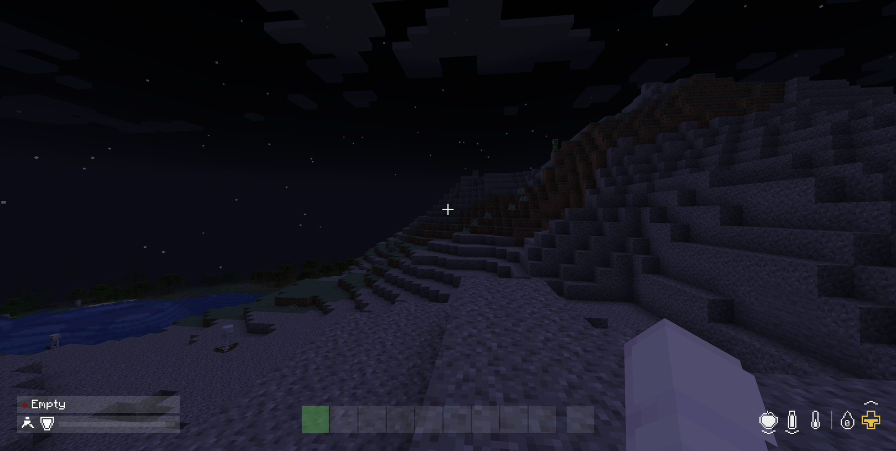
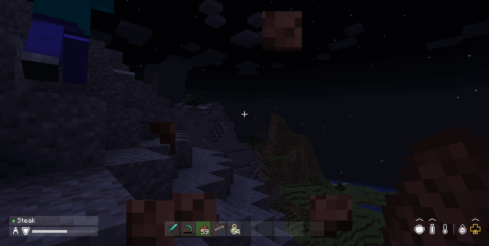
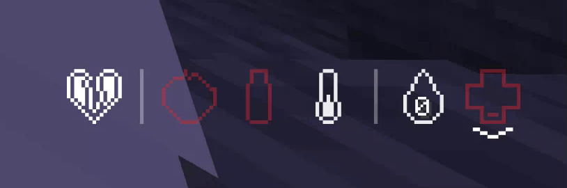
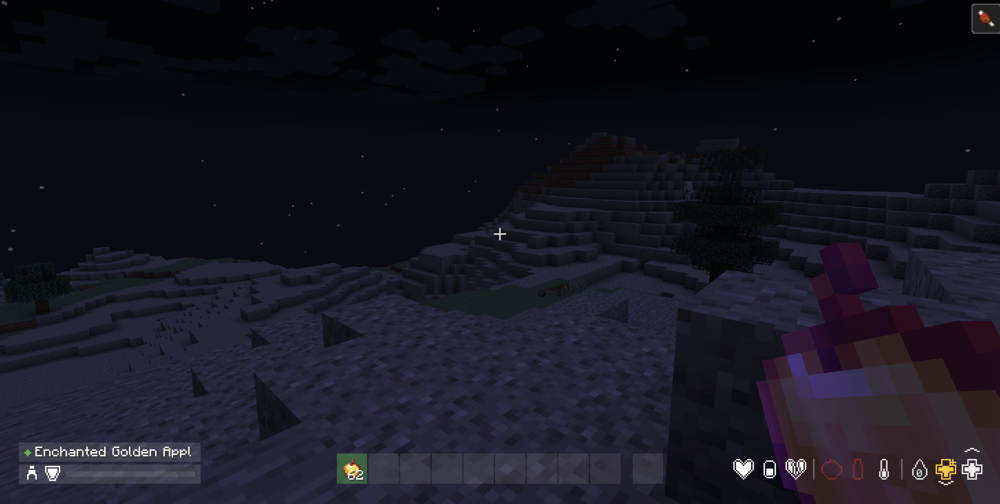
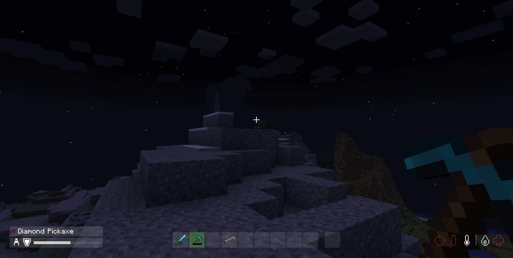

# DayZ Hotbar

[English](README.md) · [中文](README.zh.md) · [Français](README.fr.md) · [日本語](README.ja.md) · **한국어**

[](https://modrinth.com/mod/dayz-hotbar)
[](https://www.curseforge.com/minecraft/mc-mods/dayz-hotbar)
[](https://modrinth.com/mod/dayz-hotbar/versions)
[](https://modrinth.com/mod/dayz-hotbar)
[](https://www.curseforge.com/minecraft/mc-mods/dayz-hotbar)
[](LICENSE)
[](https://github.com/aacanadaa/DayZ-Hotbar/issues)
[](https://ko-fi.com/suoim)

Minecraft의 HUD를 [DayZ Inventory](https://github.com/aacanadaa/DayZ-Inventory)와 어울리는 DayZ 스타일 핫바, 플레이어 패널, 상태 아이콘으로 교체합니다.

클라이언트 전용 모드입니다. Fabric, Forge, NeoForge 모두 별도 선행 API 모드가 필요 없습니다.




---

## 지원 버전

| Minecraft | Fabric | Forge | NeoForge | Java |
| :--- | :---: | :---: | :---: | :---: |
| **1.20.1 – 1.20.4** | ✅ | — | — | 17 |
| **1.20.5** | ✅ | — | — | 21 |
| **1.20.6 – 1.21.1** | ✅ | ✅ | ✅ | 21 |
| **1.21.2** | ✅ | — | ✅ | 21 |
| **1.21.3 – 1.21.5** | ✅ | ✅ | ✅ | 21 |
| **1.21.6 – 1.21.7** | ✅ | — | ✅ | 21 |
| **1.21.8 – 1.21.11** | ✅ | ✅ | ✅ | 21 |
| **26.1 – 26.3** | ✅ | — | ✅ | 25 |

사용 중인 Minecraft 버전과 로더에 맞는 jar를 받으세요 (예: `dayz-hotbar-fabric-1.21.1-2.0.0+mc1.21.1.jar`).

---

## 기능

### 핫바 및 점프 바
- 반투명 검은색 슬롯 9개 + 보조 손 슬롯 1개.
- 빈 슬롯은 어둡고, 아이템이 있으면 밝아지며, 슬롯 전환 시 노란색에서 초록색으로 변하고 쿨다운 중인 아이템은 빨간색으로 표시됩니다.
- 말 등 점프 가능한 탈것에 타면 핫바 위쪽에 깔끔한 점프 바가 표시되어 핫바를 가리지 않습니다.



### 상태 표시줄
- 오른쪽 아래 픽셀 아트 아이콘 (텍스처를 쓰지 않아 리소스 팩과 충돌하지 않음):
  - **효과:** 하트(이로운 효과), 알약(회복), 깨진 하트(해로운 효과) — 효과가 끝나면 서서히 사라집니다.
  - **생존:** 허기(포만감 오버레이 포함), 수분, 체온, 산소(물속에서만).
  - **생명:** 경험치(레벨 표시), 흡수(`+` 배지), 체력(탑승 시 탈것 체력).
- **Tough As Nails & Legendary Survival Overhaul 연동:** 설치되어 있으면 실제 갈증과 체온을 읽어 표시합니다(체온계 색상 변화 및 극한 상태에서 깜빡임). 없으면 수분은 허기를 따라가고 체온은 중립으로 유지됩니다.
- **위험 단계 & 추세 화살표:** 체력, 허기, 수분, 산소는 낮아지면 노란색 → 빨간색 → 깜빡임 순으로 바뀝니다. 위아래 쉐브론으로 상승/하락 속도를 보여줍니다.




### 플레이어 패널
- 왼쪽 아래에 손에 든 아이템 이름과 DayZ 내구도 점(최상, 사용감, 손상, 심한 손상, 파괴), 자세(걷기, 달리기, 웅크리기), 방어력 바를 표시합니다.
- 좁은 창이나 **GUI 크기 4**에서는 핫바 위로 자동 배치되어 겹치지 않습니다.



---

## 설정

첫 실행 시 `config/dayz_hotbar.properties`가 생성됩니다:

| 항목 | 기본값 | 설명 |
| :--- | :--- | :--- |
| `enableHotbar` | `true` | 바닐라 핫바 교체 |
| `enablePlayerPanel` | `true` | 왼쪽 아래 아이템/방어력 패널 표시 |
| `enableStatusRow` | `true` | 오른쪽 아래 상태 아이콘 표시 |
| `showJumpBar` | `true` | 탑승 시 핫바 위 점프 바 표시 |
| `showEffects` | `true` | 포션 효과 아이콘 표시 |
| `showHealth` | `true` | 체력 아이콘 표시 |
| `showFood` | `true` | 허기 아이콘 표시 |
| `showWater` | `true` | 수분 아이콘 표시 |
| `showTemperature` | `true` | 체온 아이콘 표시 |
| `showAir` | `true` | 물속 산소 아이콘 표시 |
| `showAbsorption` | `true` | 흡수 아이콘 표시 |
| `showXp` | `true` | 경험치 아이콘 표시 |
| `toughAsNailsIntegration` | `true` | Tough As Nails 갈증/체온 연동 |
| `legendarySurvivalIntegration` | `true` | Legendary Survival Overhaul 갈증/체온 연동 |

---

## 참고
- 바닐라 숨김 규칙(F1, 관전자 모드, 화면 열림)을 그대로 따릅니다.
- 핫바의 공격 표시기는 함께 제거되므로 필요하면 **비디오 설정 → 공격 표시기**를 *십자선*으로 설정하세요.

---

## 소스에서 빌드

[Stonecutter](https://stonecutter.kikugie.dev/) 기반이며 Gradle 실행에 **JDK 25**가 필요합니다:

```bash
./gradlew chiseledBuild          # 전체 50개 jar 빌드
./gradlew :fabric:1.21.1:build   # 단일 버전/로더 빌드
./gradlew matrix                 # 노드 목록 확인
```
