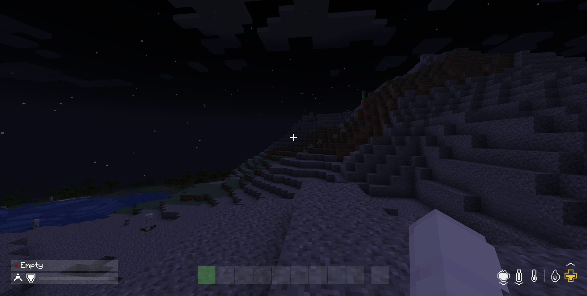
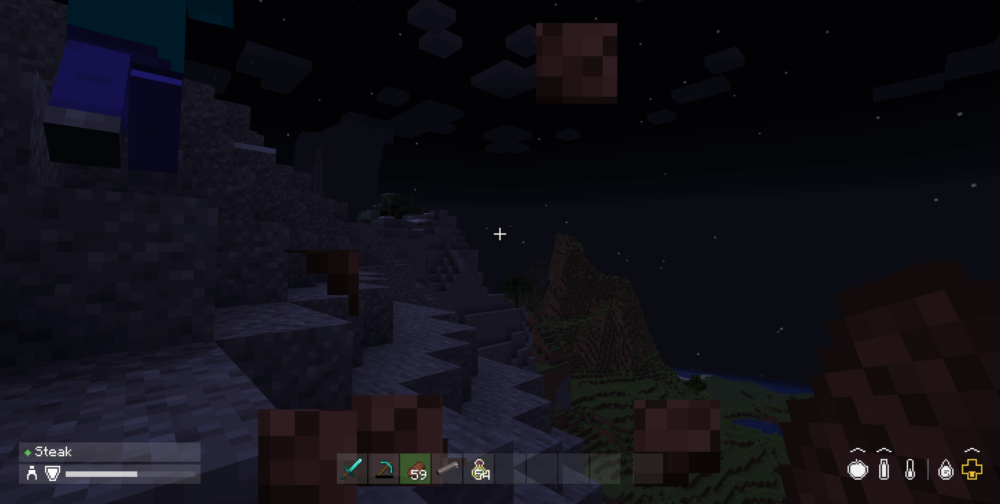
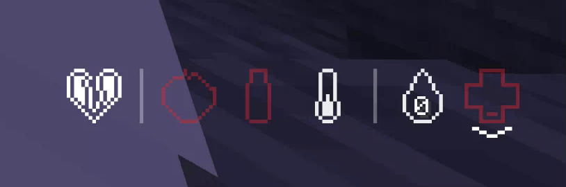
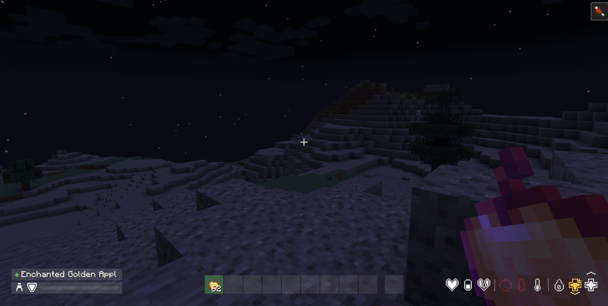
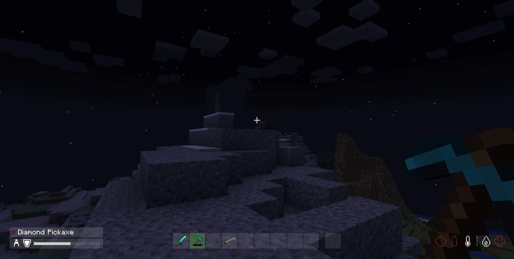

# DayZ Hotbar

**English** · [中文](README.zh.md) · [Français](README.fr.md) · [日本語](README.ja.md) · [한국어](README.ko.md)

[](https://modrinth.com/mod/dayz-hotbar)
[](https://www.curseforge.com/minecraft/mc-mods/dayz-hotbar)
[](https://modrinth.com/mod/dayz-hotbar/versions)
[](https://modrinth.com/mod/dayz-hotbar)
[](https://www.curseforge.com/minecraft/mc-mods/dayz-hotbar)
[](LICENSE)
[](https://github.com/aacanadaa/DayZ-Hotbar/issues)
[](https://ko-fi.com/suoim)

Replaces Minecraft's HUD with a DayZ-style hotbar, player panel, and status readout, made to match [DayZ Inventory](https://github.com/aacanadaa/DayZ-Inventory).

Client-side only. No API mod required on Fabric, Forge, or NeoForge.




---

## Supported Versions

| Minecraft | Fabric | Forge | NeoForge | Java |
| :--- | :---: | :---: | :---: | :---: |
| **1.20.1 – 1.20.4** | ✅ | — | — | 17 |
| **1.20.5** | ✅ | — | — | 21 |
| **1.20.6 – 1.21.1** | ✅ | ✅ | ✅ | 21 |
| **1.21.2** | ✅ | — | ✅ | 21 |
| **1.21.3 – 1.21.5** | ✅ | ✅ | ✅ | 21 |
| **1.21.6 – 1.21.7** | ✅ | — | ✅ | 21 |
| **1.21.8 – 1.21.11** | ✅ | ✅ | ✅ | 21 |
| **26.1 – 26.3** | ✅ | — | ✅ | 25 |

Grab the jar that matches both your Minecraft version and mod loader (for example `dayz-hotbar-fabric-1.21.1-2.0.0+mc1.21.1.jar`).

---

## Features

### Hotbar & Jump Bar
- 9 hotbar slots + offhand in a flat translucent row.
- Empty slots are dim, filled slots are slightly brighter, the held slot flashes yellow-to-green on swap, and items on cooldown turn red.
- When riding a horse or other jumpable mount, a compact jump bar appears above the hotbar instead of overlapping it.



### Status Readout
- Bottom-right row of pixel-art icons (no textures, so it won't clash with resource packs):
  - **Effects:** Heart (beneficial), pill (restorative), broken heart (harmful), fading out when an effect ends.
  - **Sustenance:** Food (with saturation overlay), water, temperature, and air (when underwater).
  - **Vitals:** XP drop with level number, absorption cross with `+` badge (when active), and health (or mount health while riding).
- **Tough As Nails & Legendary Survival Overhaul:** Automatically reads thirst and body temperature when either mod is installed (water tracks thirst; thermometer changes fill and color from icy blue to hot red). Without them, water mirrors food and temperature stays neutral.
- **Colour bands & trend chevrons:** Health, food, water, and air turn yellow, red, and flash red at critical levels. Chevrons above or below an icon show whether a stat is rising or falling (1 chevron for normal drift, 2 for fast changes like poison or regen).




### Player Panel
- Bottom-left cards showing your held item's name and DayZ condition dot (pristine, worn, damaged, badly damaged, ruined), plus your stance (walk, sprint, crouch) and armor bar.
- Automatically shifts above the hotbar on narrow windows or **GUI Scale 4** so nothing overlaps.



---

## Configuration

`config/dayz_hotbar.properties` is created on first launch:

| Option | Default | Description |
| :--- | :--- | :--- |
| `enableHotbar` | `true` | Replace the vanilla hotbar |
| `enablePlayerPanel` | `true` | Show the bottom-left held item & armor panel |
| `enableStatusRow` | `true` | Show the bottom-right status icons |
| `showJumpBar` | `true` | Show the DayZ jump bar above the hotbar when riding |
| `showEffects` | `true` | Show potion effect marks |
| `showHealth` | `true` | Show health icon |
| `showFood` | `true` | Show food icon |
| `showWater` | `true` | Show water icon |
| `showTemperature` | `true` | Show temperature icon |
| `showAir` | `true` | Show air icon when underwater |
| `showAbsorption` | `true` | Show absorption icon when active |
| `showXp` | `true` | Show XP icon |
| `toughAsNailsIntegration` | `true` | Read thirst & temperature from Tough As Nails |
| `legendarySurvivalIntegration` | `true` | Read thirst & temperature from Legendary Survival Overhaul |

---

## Notes
- Vanilla visibility rules still apply (F1, spectator mode, open screens).
- Attack Indicator in the hotbar is removed with the vanilla hotbar; set **Video Settings → Attack Indicator** to *Crosshair* if you want it.

---

## Building from Source

Uses [Stonecutter](https://stonecutter.kikugie.dev/) with JDK 25 as the launcher JDK:

```bash
./gradlew chiseledBuild          # Build all 50 jars
./gradlew :fabric:1.21.1:build   # Build a single version/loader
./gradlew matrix                 # List all nodes
```
