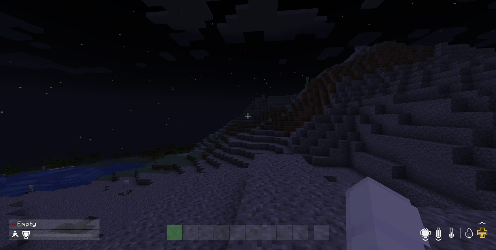
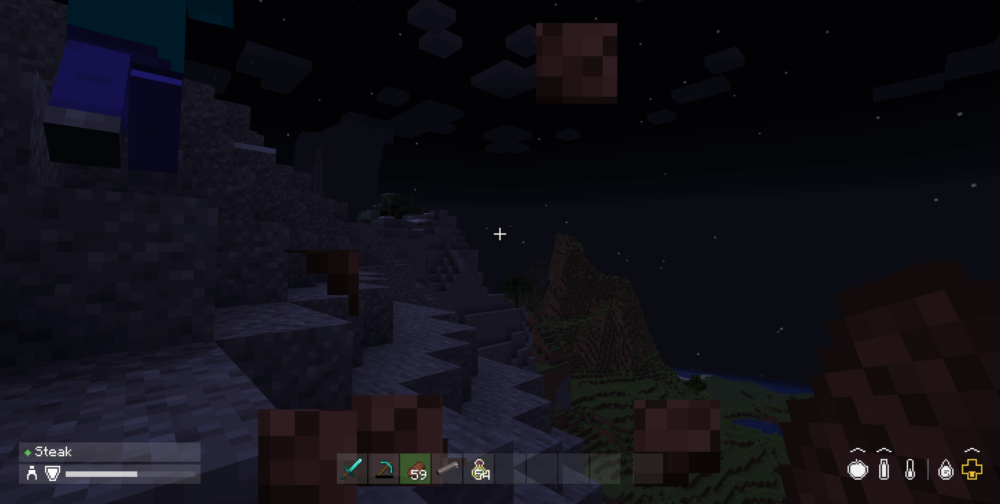
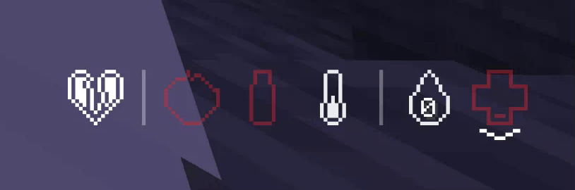
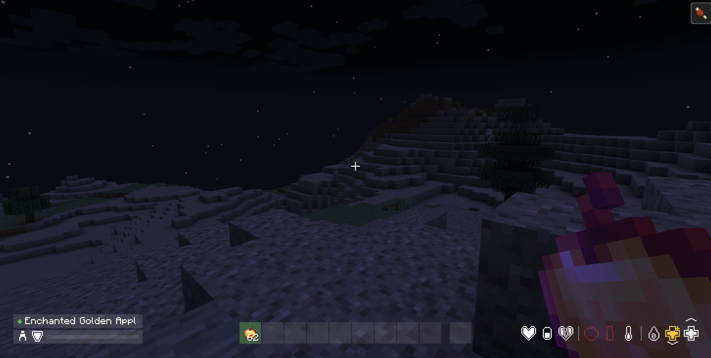
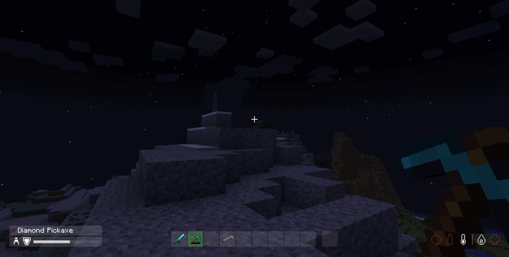

# DayZ Hotbar

[English](README.md) · **中文** · [Français](README.fr.md) · [日本語](README.ja.md) · [한국어](README.ko.md)

[](https://modrinth.com/mod/dayz-hotbar)
[](https://www.curseforge.com/minecraft/mc-mods/dayz-hotbar)
[](https://modrinth.com/mod/dayz-hotbar/versions)
[](https://modrinth.com/mod/dayz-hotbar)
[](https://www.curseforge.com/minecraft/mc-mods/dayz-hotbar)
[](LICENSE)
[](https://github.com/aacanadaa/DayZ-Hotbar/issues)
[](https://ko-fi.com/suoim)

将 Minecraft 的 HUD 替换为 DayZ 风格的快捷栏、玩家面板和状态读数，视觉风格与 [DayZ Inventory](https://github.com/aacanadaa/DayZ-Inventory) 一致。

纯客户端模组。Fabric、Forge 和 NeoForge 均不需要额外前置 API 模组。




---

## 支持的版本

| Minecraft | Fabric | Forge | NeoForge | Java |
| :--- | :---: | :---: | :---: | :---: |
| **1.20.1 – 1.20.4** | ✅ | — | — | 17 |
| **1.20.5** | ✅ | — | — | 21 |
| **1.20.6 – 1.21.1** | ✅ | ✅ | ✅ | 21 |
| **1.21.2** | ✅ | — | ✅ | 21 |
| **1.21.3 – 1.21.5** | ✅ | ✅ | ✅ | 21 |
| **1.21.6 – 1.21.7** | ✅ | — | ✅ | 21 |
| **1.21.8 – 1.21.11** | ✅ | ✅ | ✅ | 21 |
| **26.1 – 26.3** | ✅ | — | ✅ | 25 |

请下载同时匹配你游戏版本与加载器的 jar（例如 `dayz-hotbar-fabric-1.21.1-2.0.0+mc1.21.1.jar`）。

---

## 功能介绍

### 快捷栏与跳跃蓄力条
- 9 个快捷栏位加副手栏，采用扁平半透明黑底。
- 空栏偏暗、有物品时略亮，切换手中物品时呈黄转绿过渡，物品处于冷却时显示红色。
- 骑乘马匹等可跳跃坐骑时，会在快捷栏上方显示紧凑的 DayZ 风格跳跃条，不再遮挡快捷栏。



### 状态读数
- 右下角横向排列的像素图标（纯绘制无贴图，不与材质包冲突）：
  - **效果：** 心形（增益）、胶囊（恢复）、碎心（减益），效果结束时渐隐消失。
  - **维生：** 饥饿（带饱和度叠层）、口渴、体温、氧气（仅在水下显示）。
  - **生命：** 经验水滴（内含等级数字）、伤害吸收十字（带 `+` 徽章）、生命值（骑乘时显示坐骑生命）。
- **兼容 Tough As Nails 与 Legendary Survival Overhaul：** 安装任一模组时自动读取口渴值与体温（水瓶跟随真实口渴值，温度计根据冷暖变色并在过冷/过热时闪烁）。未安装时，水瓶镜像饥饿值、温度计保持中性。
- **颜色分段与趋势箭头：** 生命、饥饿、口渴与氧气在偏低时依次变为黄色、红色并闪烁。图标上下方的箭头指示数值变化方向（1 格为常规变化，2 格为剧烈变化，如中毒或再生）。




### 玩家面板
- 左下角显示手持物品名称与 DayZ 耐久圆点（完好、磨损、受损、严重受损、损毁），以及当前姿态（行走、疾跑、潜行）和护甲条。
- 在窄窗口或 **GUI 尺寸 4** 下会自动上移到快捷栏上方，互不重叠。



---

## 配置文件

首次启动会生成 `config/dayz_hotbar.properties`：

| 选项 | 默认值 | 说明 |
| :--- | :--- | :--- |
| `enableHotbar` | `true` | 替换原版快捷栏 |
| `enablePlayerPanel` | `true` | 显示左下角手持物品与护甲面板 |
| `enableStatusRow` | `true` | 显示右下角状态图标 |
| `showJumpBar` | `true` | 骑乘时在快捷栏上方显示跳跃条 |
| `showEffects` | `true` | 显示药水效果标记 |
| `showHealth` | `true` | 显示生命值图标 |
| `showFood` | `true` | 显示饥饿值图标 |
| `showWater` | `true` | 显示口渴/水分图标 |
| `showTemperature` | `true` | 显示体温图标 |
| `showAir` | `true` | 水下显示氧气图标 |
| `showAbsorption` | `true` | 有伤害吸收时显示图标 |
| `showXp` | `true` | 显示经验图标 |
| `toughAsNailsIntegration` | `true` | 读取 Tough As Nails 的口渴与体温 |
| `legendarySurvivalIntegration` | `true` | 读取 Legendary Survival Overhaul 的口渴与体温 |

---

## 说明
- 遵循原版隐藏规则（F1、旁观模式、打开界面时自动隐藏）。
- 快捷栏内的攻击冷却指示器会随原版快捷栏一并移除；需要的话请在 **视频设置 → 攻击指示器** 中改为 **准星**。

---

## 从源码构建

基于 [Stonecutter](https://stonecutter.kikugie.dev/)，需要 **JDK 25** 启动 Gradle：

```bash
./gradlew chiseledBuild          # 构建全部 50 个 jar
./gradlew :fabric:1.21.1:build   # 构建单个版本/加载器
./gradlew matrix                 # 查看所有节点
```
